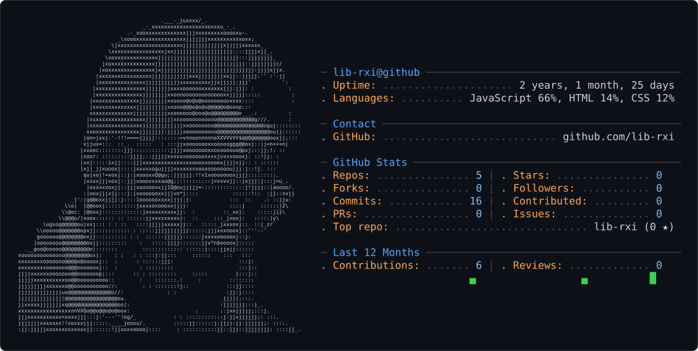

# Hi there 👋

<picture>
  <source media="(prefers-color-scheme: dark)" srcset="dark_mode.svg" />
  <source media="(prefers-color-scheme: light)" srcset="light_mode.svg" />
  
</picture>

I'm a security engineer who likes to build things. Most of what I write is tooling: scanners, custom rules, parsers and small automations that make security less manual.

- 🔭 Building security automation and the occasional browser extension
- 🧰 Mostly Python and JavaScript, with some Rust on the side
- 🔌 Tinkering with ESP32 and M5Stick boards, e-paper displays and Raspberry Pi
- 🌱 Currently exploring AI agents and MCP servers

## Projects

- [Snipper](https://github.com/lib-rxi/Snipper) – a simple bookmark plugin for Chrome
